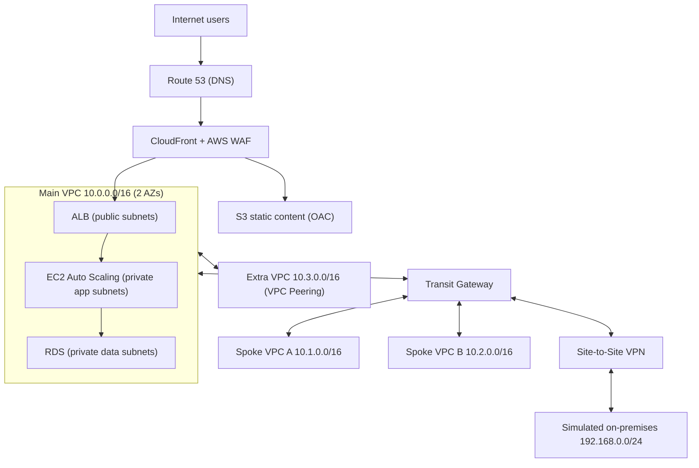

# DEPI Capstone Project: Secure AWS Network Architecture & Hybrid Connectivity

> **Program:** Digital Egypt Pioneers Initiative (DEPI)  
> **Track:** AWS Security Cloud Computing  
> **Status:** 🟡 Phase 0 complete — design documentation v1 published, implementation starting  
> **IaC Status:** ⚪ Not yet deployed — Week 1 implementation is planned, not built  

---

## 📌 Project Overview

This repository hosts the graduation capstone project for the **AWS Security Cloud Computing Track** under the **Digital Egypt Pioneers Initiative (DEPI)**.

Our team of six is designing and implementing a **Secure AWS Network Architecture with Hybrid Connectivity** based on the AWS Well-Architected Framework (Security and Reliability pillars). The goal is a segmented, multi-AZ cloud network that securely interconnects multiple environments, protects the public edge against web-layer threats, and gives us the visibility to detect and contain a compromised instance.

---

## 🚦 Current State

- ✅ Project proposal, plan, requirements and architecture design drafted (v1) — see the [documentation index](#-documentation-index)
- ✅ Architecture diagram v1 — [`docs/03-design/overall-architecture.drawio`](docs/03-design/overall-architecture.drawio)
- ✅ Repository workspace scaffolded (`docs/`, `terraform/`, `architecture/`, `.github/`)
- 🟡 Design documents are **drafts**. Items marked `TODO` are open decisions to close during implementation.
- ⚪ **Terraform implementation: not started.** `terraform/` contains directory structure only.

**No infrastructure has been provisioned. No AWS resources exist yet.** Diagrams and documents describe the *planned* design. A component is only described as deployed once evidence (screenshots, test output, Terraform state summary) is committed.

---

## 📚 Documentation Index

| Area | Document |
| :--- | :--- |
| Planning | [Project proposal](docs/01-planning/01-project-proposal.md) — problem, objectives, Build / Lab / Concept scope |
| Planning | [Project plan](docs/01-planning/02-project-plan.md) — phases, Gantt, roles, risks, KPIs |
| Requirements | [Requirements](docs/02-requirements/02-requirements.md) — stakeholders, use cases, user stories, FR / NFR |
| Design | [Architecture](docs/03-design/03-architecture.md) — CIDR plan, routing, TGW segmentation, SG matrix, traffic flows, decisions |
| Design | [Architecture diagram](docs/03-design/overall-architecture.drawio) — draw.io source (open at app.diagrams.net) |
| Week 1 | [VPC core design](docs/week-1-vpc-core.md) |
| Spec | [Target architecture & CIDR plan](architecture/README.md) |

---

## 🎯 Target Architecture Vision

A multi-tier VPC behind an edge layer, connected through a Transit Gateway hub to spoke VPCs and a simulated on-premises site:



Key design points:
- The ALB accepts traffic **only from CloudFront** (origin-facing prefix list plus a secret header), so the WAF cannot be bypassed.
- Data subnets have **no default route**; administration uses **SSM Session Manager** (no bastion, no inbound SSH).
- Spoke A and Spoke B can reach the hub but **not each other** (Transit Gateway route tables).
- On-premises is **simulated** (strongSwan on EC2) because we have no physical router.

---

## 🧭 Scope: Build / Lab / Concept

| Level | Components |
| :--- | :--- |
| **Build** (deployed and tested) | VPC, subnets, IGW, NAT, SG/NACL, EC2 ASG, ALB, RDS, SSM, VPC Peering, VPC endpoints, Transit Gateway, CloudFront + S3 (OAC), WAF, Flow Logs + Athena, CloudWatch alarms, incident response exercise |
| **Lab** (short controlled demo) | Site-to-Site VPN (simulated), Client VPN, Route 53 health checks, Traffic Mirroring (TBD) |
| **Concept** (documented and compared) | Direct Connect, Shield Advanced, Firewall Manager, Global Accelerator |

Full justification: [project proposal](docs/01-planning/01-project-proposal.md).

---

## 🚀 Next Milestone: Week 1 — Core VPC Foundation

Week 1 implements the network foundation described in [`docs/week-1-vpc-core.md`](docs/week-1-vpc-core.md).

### 📋 Week 1 Objectives & Deliverables
- [ ] **IP Addressing & CIDR Design:** `10.0.0.0/16` across 2 Availability Zones, with a documented allocation rule.
- [ ] **Multi-Tier Subnet Segmentation:**
  - Public subnets for the load balancer and NAT gateway.
  - Private application subnets for compute workloads.
  - Isolated data subnets with no default route to the internet.
- [ ] **Ingress & Egress Controls:** Internet Gateway (IGW) and NAT Gateway (single NAT during labs; two NATs documented as the production target).
- [ ] **Least-Privilege Security Groups:** Strict chain `sg-alb` ➔ `sg-app` ➔ `sg-data`.
- [ ] **Network ACLs:** Stateless subnet-level rules per tier.
- [ ] **Workload:** EC2 Auto Scaling Group, Application Load Balancer, RDS.
- [ ] **Secure Management Plane:** No public bastion and no direct SSH (port 22); use **AWS Systems Manager (SSM) Session Manager**.
- [ ] **Connectivity test results** and architecture diagram.
- [ ] **Initial IaC Implementation:** Terraform module `01-vpc-core` — **planned, not yet written.**

---

## 🗺️ Project Roadmap (High-Level Phases)

Dates follow the Industry DEPI documentation schedule (final submission 4 Dec 2026).

| Phase | Milestone | Focus Area | Target dates (2026) | Design | Implemented |
| :---: | :--- | :--- | :---: | :---: | :---: |
| **Phase 0** | **Proposal & Architecture** | Scope, requirements, target architecture, workspace setup | 5–6 Nov | ✅ | ✅ docs + repo |
| **Week 1** | **Core VPC Foundation** | Multi-AZ subnets, routing, NAT, SG/NACL, EC2/ALB/RDS, SSM | 7–12 Nov | ✅ | ⚪ Planned |
| **Week 2** | **Hybrid Connectivity & Hub Routing** | Peering, VPC endpoints, Transit Gateway, Site-to-Site VPN, Client VPN | 13–19 Nov | ✅ | ⚪ Planned |
| **Week 3** | **Edge Security & Application Protection** | CloudFront, S3 (OAC), AWS WAF, Route 53, edge concepts | 20–24 Nov | ✅ | ⚪ Planned |
| **Week 4** | **Observability & Incident Response** | VPC Flow Logs, Athena, CloudWatch, host isolation, evidence | 25–29 Nov | ✅ | ⚪ Planned |
| **Final** | **Report & Presentation** | Final report, presentation, demo, cleanup | 30 Nov–4 Dec | ⚪ | ⚪ Planned |

> **Design vs. Implemented** are tracked separately on purpose: the architecture has been
> specified ahead of the build, but no Terraform has been applied.

---

## 👥 Team

Team of 6. Each member owns specific deliverables and must be able to explain them in the final presentation.

| Member | GitHub | Responsibility |
| :--- | :--- | :--- |
| TODO | TODO | TODO |
| TODO | TODO | TODO |
| TODO | TODO | TODO |
| TODO | TODO | TODO |
| TODO | TODO | TODO |
| TODO | TODO | TODO |

> Suggested ownership split: core VPC and routing · security groups, NACLs and IAM · hybrid connectivity (TGW, VPN) · edge security (CloudFront, WAF, Route 53) · monitoring and incident response · documentation, diagrams and cost control. Everyone reviews pull requests.

---

## 💰 Cost and Security Rules

- Several services bill **hourly** (NAT Gateway, Transit Gateway attachments, VPN, ALB, RDS, interface endpoints, Client VPN). Build in short sessions and **tear down after each session** (`terraform destroy`).
- Set an AWS Budgets alert before deploying anything.
- **Never commit** credentials, access keys, private keys, `.tfstate` files or account IDs. Check `.gitignore` and review diffs before pushing.
- Only test attacks against resources we own inside this project's account.

---

## 📁 Repository Structure

```text
depi-aws-network-architecture/
├── .github/                 # Pull request template (CI added once Terraform lands)
├── architecture/            # Target architecture spec & CIDR allocation plan
│   └── diagrams/            # Network diagrams (to be added)
├── docs/
│   ├── 01-planning/         # Proposal, project plan (roles, risks, KPIs)
│   ├── 02-requirements/     # Stakeholders, use cases, FR / NFR
│   ├── 03-design/           # Architecture design and draw.io diagram
│   └── week-1-vpc-core.md   # Sprint deliverables & design notes
├── terraform/               # Infrastructure as Code workspace
│   ├── environments/        # Root modules per environment (dev/, prod/)
│   └── modules/             # Reusable modules (01-vpc-core/, …)
├── .gitignore               # Terraform & AWS credential ignore rules
├── CONTRIBUTING.md          # Team collaboration and branch conventions
└── README.md                # Project overview and milestone tracker
```

Test evidence, screenshots and runbooks will be added under `docs/` as each week is implemented.

---

## 🌿 Team Workflow

To ensure smooth collaboration across the team:
- The `main` branch tracks verified, review-approved milestones.
- Work for the current sprint is developed in feature branches (e.g., `feat/week-1-vpc-subnets`).
- Each feature must be tested and reviewed by at least one other member before merging into `main`.
- Documentation changes follow the same flow; keep documents aligned with what is actually deployed.
- See [`CONTRIBUTING.md`](CONTRIBUTING.md) for branch naming, commit conventions, and the PR process.

---

## 📜 Acknowledgments

Developed as part of the **Digital Egypt Pioneers Initiative (DEPI)**, sponsored by the **Ministry of Communications and Information Technology (MCIT)**, Egypt.
