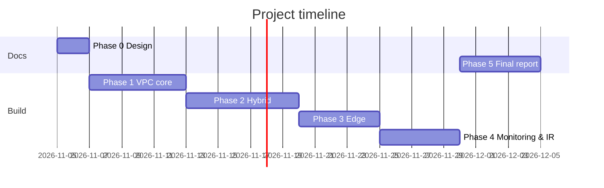

# Project Plan

**Status:** Draft v1

## 1. Phases and Milestones

| Phase | Dates (2026) | Scope | Milestone / exit evidence |
|---|---|---|---|
| 0. Design | 5–6 Nov | Requirements, scope, CIDR plan, diagrams, repo | M0: design docs pushed to GitHub |
| 1. VPC core | 7–12 Nov | VPC, subnets, IGW, NAT, SG/NACL, EC2, ALB, RDS, SSM | M1: connectivity tests pass, SG/NACL matrix |
| 2. Hybrid & connectivity | 13–19 Nov | Peering, endpoints, TGW, VPN, Client VPN lab | M2: segmentation and hybrid test report |
| 3. Edge security | 20–24 Nov | CloudFront + S3, WAF, Route 53, edge concepts | M3: WAF block/allow tests |
| 4. Monitoring & IR | 25–29 Nov | Flow Logs, Athena, CloudWatch, IR exercise | M4: queries, runbook, evidence notes |
| 5. Finalization | 30 Nov–4 Dec | Final report, presentation, cleanup | M5: final submission |

## 2. Task Hierarchy

Project → Phase → Milestone → Task → Subtask. Each task has an ID (`P1-T03`), objective, prerequisites, steps, expected result, verification method, documentation deliverable and a status: Not Started / Studying / Designing / In Progress / Blocked / Testing / Completed. A task is Completed only with verification evidence. The task tracker lives in `docs/02-project-plan.md` (this file) and is updated weekly.

## 3. Roles and Responsibilities

| Role | Person | Responsibility |
|---|---|---|
| Project owner / engineer | Hisham Mohamed | Design, implementation, testing, documentation, presentation |
| Instructor | DEPI instructor | Review and evaluation |

TODO(Hisham): the DEPI rules require teams of 4–6. Confirm with the instructor how a solo project is handled.

## 4. Risk Assessment

| ID | Risk | Likelihood | Impact | Mitigation |
|---|---|---|---|---|
| R1 | Cost overrun from hourly services (NAT, TGW, VPN, ALB, RDS, Client VPN) | High | High | Budget alert, teardown after each session, IaC rebuild, Client VPN only for a short lab |
| R2 | Lock-out from a wrong SG/NACL/route change | Medium | Medium | SSM access, change one layer at a time, keep rollback notes |
| R3 | Site-to-Site VPN simulation fails | Medium | Medium | Time-box, fall back to documenting the design with partial evidence |
| R4 | Schedule slip (25 days to build) | Medium | High | Strict phase exit criteria, documentation written during each phase |
| R5 | Credentials or keys leaked to GitHub | Low | High | `.gitignore`, no secrets in repo, git-secrets or pre-commit scan, IAM roles |
| R6 | Documentation shows resources that were not built | Medium | High | Diagrams carry a "planned/deployed" label, evidence required |
| R7 | Solo project vs. team requirement | Medium | Medium | Clarify with the instructor now |

## 5. KPIs

| KPI | Target | How measured |
|---|---|---|
| Private-tier instances with public IPs | 0 | EC2 console / CLI query |
| Direct access to the ALB bypassing CloudFront | Blocked | curl to ALB DNS name |
| Spoke A ↔ Spoke B traffic | Blocked | ping/curl test |
| Spokes and on-premises reaching Main | Allowed | ping/curl test |
| WAF test attacks (SQLi, XSS, rate limit) | Blocked | WAF logs, HTTP status codes |
| Flow Logs queryable in Athena | Yes | saved queries with results |
| Time to isolate a compromised instance | Documented in the runbook | timed IR exercise |
| Phase documentation completed on time | 5 of 5 | repo commits |
| Total lab cost | Under the cap | AWS Cost Explorer |
